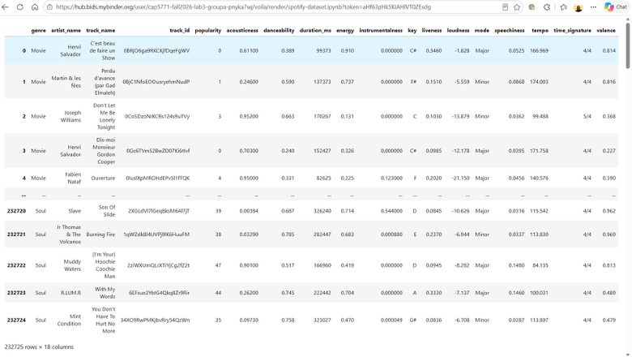
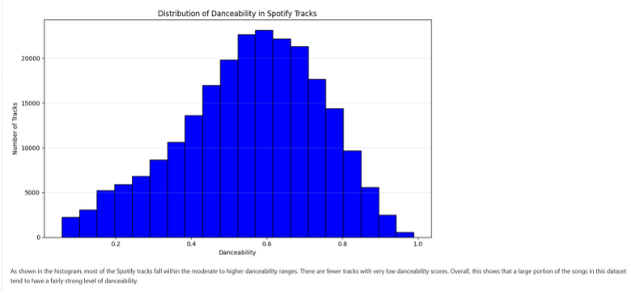
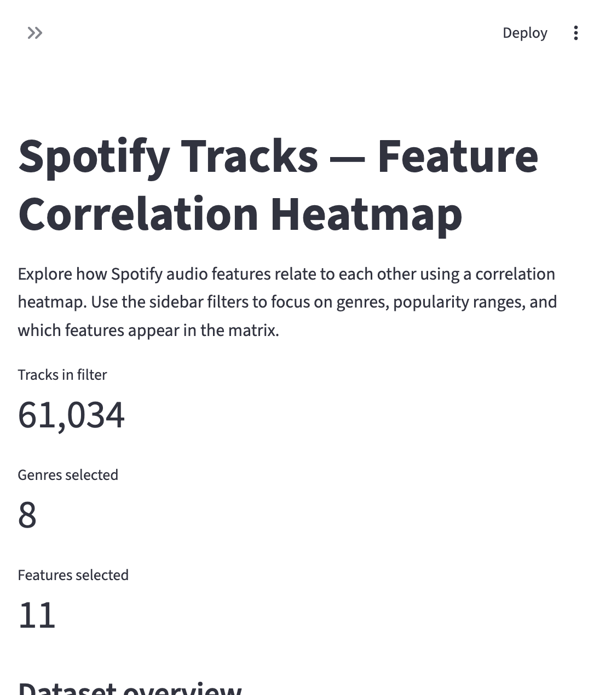
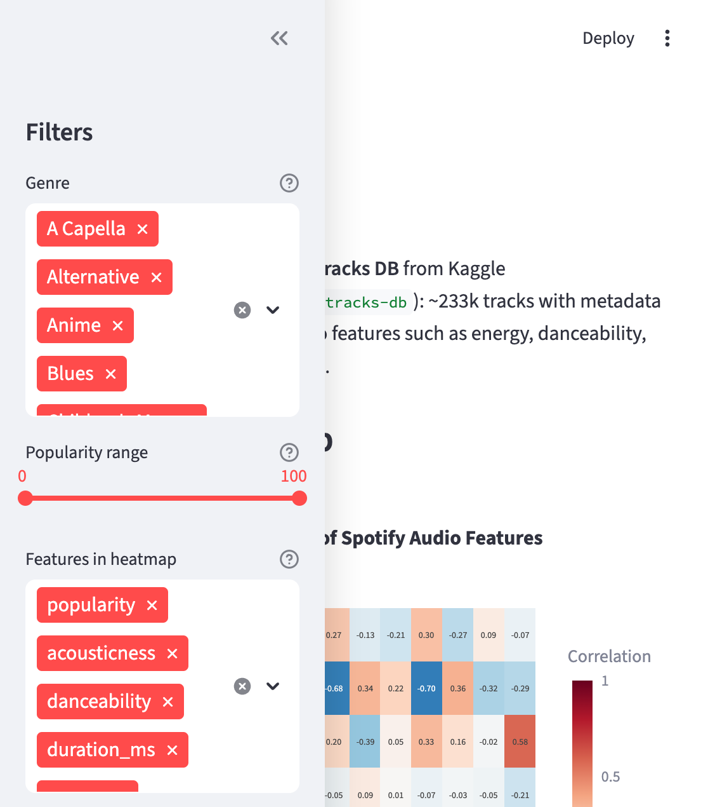

# lab3-groupa

**Group members:** Johnny Dai, Kendrick Jones, Sammy Morales

Collaborative lab: interactive Spotify data visualization and deployment experiments (Voilà, Binder, Streamlit, Docker). We explore how Spotify audio features relate to each other and to popularity, then deploy the visualizations as a Voilà dashboard, on Binder, as a Streamlit app, and as a Docker image.

## Dataset

[Ultimate Spotify Tracks DB](https://www.kaggle.com/datasets/zaheenhamidani/ultimate-spotify-tracks-db) — track metadata and audio features used in `visualize.ipynb`.

The dataset has 232,725 tracks and 18 columns, with no missing values. Each row is one track, with metadata (`genre`, `artist_name`, `track_name`, `track_id`), a `popularity` score from 0 to 100, and audio features from the Spotify Web API. These include `acousticness`, `danceability`, `energy`, `loudness`, `tempo` and `valence`. The tracks cover 26 genres with about 9,000 tracks each.

## Setup

1. Install [uv](https://github.com/astral-sh/uv) (or use pip).
2. Create a virtual environment and install dependencies:

```bash
uv venv
source .venv/bin/activate
uv pip install -r requirements.txt
```

Or with pip:

```bash
python3 -m venv .venv
source .venv/bin/activate
pip install -r requirements.txt
```

3. Open the notebook:

```bash
jupyter notebook visualize.ipynb
```

## Notebook

`visualize.ipynb` loads the Spotify dataset via `kagglehub`, describes the features, and shows:

- A danceability histogram
- An **interactive Plotly correlation heatmap** of audio features
- A short interpretation of the patterns

## Voilà

Run the notebook as a dashboard, with the code hidden, at http://localhost:8866:

```bash
source .venv/bin/activate
voila visualize.ipynb
```


## Binder

[](https://mybinder.org/v2/gh/CAP5771-Fall2026/lab3-groupa/9b5d190?urlpath=voila%2Frender%2Fspotify-dataset.ipynb)

Binder URL: https://mybinder.org/v2/gh/CAP5771-Fall2026/lab3-groupa/9b5d190?urlpath=voila%2Frender%2Fspotify-dataset.ipynb

The first launch can take a few minutes while Binder builds the environment.




## Streamlit app (Part 3)

Run the interactive heatmap app locally:

```bash
source .venv/bin/activate
streamlit run app.py
```

Interactive controls in the sidebar:

- **Genre** multiselect filter
- **Popularity range** slider
- **Features in heatmap** multiselect
- **Color scale** dropdown




## Docker

**Docker Hub:** https://hub.docker.com/repository/docker/jdai8787/spotify-heatmap/general

### Docker demonstration: pull and run the image

```bash
docker pull jdai8787/spotify-heatmap:latest
docker run -d --name spotify-heatmap -p 8501:8501 jdai8787/spotify-heatmap:latest
```

Open http://localhost:8501. To stop the container and remove it, run `docker rm -f spotify-heatmap`.

### Build the image yourself

The `Dockerfile` installs only the app's dependencies (`requirements-app.txt`). It also downloads the Kaggle dataset while the image is being built, so the container doesn't need to download anything when it starts.

```bash
docker build -t spotify-heatmap .
docker run -d --name spotify-heatmap -p 8501:8501 spotify-heatmap
```

Open http://localhost:8501. If port 8501 is already in use (for example, by a local `streamlit run`), map the app to a different port with `-p 8502:8501`.

To stop the container and remove it:

```bash
docker rm -f spotify-heatmap
```
